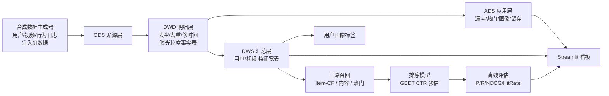

# 短视频内容推荐系统（抖音式）· Short-Video RecSys

> 一个**同时覆盖数据开发（Data Development）与数据科学（Data Science）**全链路的端到端项目：从埋点数据 → 数仓建模 → 多维分析 → 召回/排序推荐 → 可视化看板。零基础设施依赖（纯 Python + SQLite + Streamlit，无需 Docker / 集群），本地一键复现，可直接写入简历。

---

## 🎯 为什么做这个项目（对准腾讯 / 字节数据岗）

调研了字节跳动、腾讯的**数据开发**与**数据科学**校招 JD 后，本项目刻意覆盖两类岗位共同看重的闭环能力：

| 岗位能力（JD 高频要求） | 本项目对应实现 |
|---|---|
| SQL 复杂查询、数仓建模、ETL | ODS→DWD→DWS→ADS 分层 + 星型模型，全部用 SQL/Python 实现 |
| 数据质量治理 | 故意注入脏数据（空值/重复/乱序迟到），ETL 阶段清洗并量化治理结果 |
| 用户画像 / 特征工程 | 品类偏好建模、用户/视频特征宽表 |
| 机器学习 / 推荐算法 | 三路召回（协同过滤+内容+热门）+ GBDT 排序（CTR 预估） |
| 多维分析与业务洞察 | 转化漏斗、品类热度、时段分布、用户留存 |
| 数据可视化 / 看板 | Streamlit 交互式看板 |
| 可解释、可复现、可讲清楚 | 固定随机种子，全流程一键跑通，附面试可聊点 |

---

## 🧱 技术栈

- **语言**：Python 3.10+
- **数据处理**：pandas / numpy
- **机器学习**：scikit-learn（GBDT / LogisticRegression）
- **数仓**：SQLite（本地零配置；建模思想与 Hive/Spark 数仓一致，可平滑迁移）
- **可视化**：Streamlit + matplotlib
- **工程**：模块化分层设计、配置集中管理、一键流水线

---

## 🏗️ 系统架构



**数仓模型（星型）**：事实表 `dwd_exposure`（曝光粒度）+ 维度表 `dim_user` / `dim_video`，沿用工业界 ODS→DWD→DWS→ADS 分层规范。

---

## 📁 项目结构

```
short-video-recsys/
├── config.py              # 全局配置（数据规模/维度/模型参数）
├── run_all.py             # 一键流水线：生成→ETL→分析→推荐
├── app.py                 # Streamlit 可视化看板
├── requirements.txt
├── src/
│   ├── data_generator.py  # 合成短视频行为数据（含脏数据）
│   ├── etl.py             # ODS→DWD→DWS→ADS 数仓建模
│   ├── analysis.py        # SQL 多维分析（漏斗/留存/时段）
│   ├── db.py              # SQLite 数仓助手
│   └── recsys/
│       ├── recall.py      # 召回：Item-CF / 内容 / 热门
│       ├── ranking.py     # 排序：特征工程 + GBDT/Logistic
│       ├── evaluate.py    # 评估：Precision/Recall/NDCG/HitRate
│       ├── profile.py     # 用户画像标签化
│       └── pipeline.py    # 主流程编排 + 落库
└── data/                  # 生成物（raw 与 warehouse 已被 .gitignore 忽略）
```

---

## 📊 数据集说明

数据为**合成但贴近真实**的抖音式行为数据（因真实公司数据不可得，刻意构造生产级特征）：

- **用户维表**：5,000 人，含城市线级、年龄、性别、注册渠道、设备、活跃度，以及隐式"品类偏好"
- **视频维表**：2,000 条，含品类、时长、标签、作者
- **行为日志**：约 29.8 万条事件（曝光/点击/播放/完播/点赞/评论/转发/关注），漏斗逐级衰减
- **刻意注入的脏数据**（考验数据治理能力）：空 `user_id`、重复事件、乱序/迟到时间戳、机器人异常行为

---

## 🚀 快速开始

```bash
# 1. 安装依赖
pip install -r requirements.txt

# 2. 一键跑通全链路（约 1~2 分钟）
python run_all.py

# 3. 启动可视化看板（浏览器自动打开）
streamlit run app.py
```

> 数据、数仓、推荐结果均由 `run_all.py` 复现，**无需任何外部文件**。`data/raw/*.csv` 与 `data/warehouse/*.db` 已被 `.gitignore` 忽略。

---

## 📈 真实产出指标（来自 `data/metrics.json`，可复现）

**数据质量治理**：原始事件 298,529 条 → 丢弃空 user_id 1,502、去重 2,950、标记迟到 5,834 → 清洗后有效曝光 **199,629** 条。

**整体转化漏斗**：曝光 199,629 → 点击 40,239（**CTR 20.2%**）→ 完播 15,536（**完播率 38.6%**）→ 点赞 2,534（**点赞率 16.3%**）。

**用户留存**：首日群 D1=93.4% / D3=93.8% / D7=94.4%（合成数据强回访特征）。

**推荐系统离线评估**（留出法，GBDT 排序，Top-K）：

| 指标 | @10 | @20 |
|---|---|---|
| Precision | 0.0123 | 0.0104 |
| Recall | 0.0585 | 0.1012 |
| NDCG | 0.0558 | 0.0959 |
| HitRate | 0.117 | 0.189 |

> 指标解读：在 2,000 个候选、隐式反馈稀疏（正样本占比 7.8%）的条件下，HitRate@10≈11.7% 是合理基线；召回瓶颈主要在 Item-CF 覆盖度，后续可用双塔向量召回 / 负采样优化（见末尾）。

---

## 🔍 面试可聊点（被问到能讲 15 分钟）

1. **数据流（Data Flow）**：埋点日志 → ODS → DWD（去空/去重/修时间，事件粒度 pivot 成曝光粒度事实表）→ DWS（用户/视频特征宽表）→ ADS（漏斗/画像）→ 召回 → 排序 → 看板。
2. **踩过的坑 / 数据质量**：真实数据有空值、重复、乱序迟到；ETL 用"先量化后清洗"——先统计丢弃量，再针对性处理，保证可解释。
3. **10 倍数据量怎么办**：当前 SQLite 单机；迁移路径是 Hive/Spark（分区表 + 列式存储）+ Kafka 实时流；召回用 Faiss/Annoy 做向量近邻；排序上特征平台 + 在线推理。
4. **召回为什么多路融合**：单路召回覆盖不足，Item-CF 抓"相似兴趣"、内容召回抓"品类匹配"、热门召回保冷启动；融合前各路分数**归一化**避免高热度分淹没协同过滤分。

---

## 📝 简历条目参考

> **短视频内容推荐系统**　*独立项目*
> - 基于 Python + SQLite 从零搭建抖音式推荐数据链路：设计 ODS/DWD/DWS/ADS 分层数仓与星型模型，编写 ETL 清洗 29.8 万条埋点日志（空值/重复/乱序治理），SQL 输出转化漏斗与用户留存；
> - 实现三路召回（Item-CF / 内容 / 热门）+ GBDT 排序的推荐引擎，离线评估 HitRate@10=11.7%；构建用户画像与 Streamlit 交互看板；
> - 全流程固定随机种子可复现，代码已开源至 GitHub。

---

## 🛠️ 可优化方向（体现成长性）

- 召回：引入双塔 / 向量召回（Faiss）提升 Item-CF 覆盖度
- 排序：特征交叉、负采样优化、Online Learning
- 工程：Hive/Spark 迁移、Airflow 调度、实时流（Kafka/Flink）
- 实验：A/B 实验框架、因果推断评估

---

## 📜 声明

本项目为学习/求职用途的**合成数据**演示，不含任何真实用户隐私数据。
